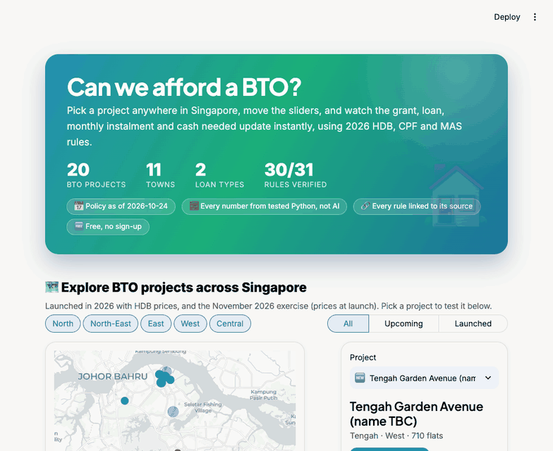
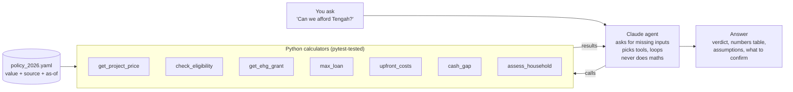

# 🏠 BTO Affordability Agent

[](https://github.com/maureenkai15/bto-affordability-agent/actions/workflows/tests.yml)


**"Can we afford a 4-room BTO in Tengah?"** An AI agent that answers this for any Singapore household, using 2026 HDB and CPF rules, and shows exactly where every number comes from.



**Live app:** _add your Streamlit Cloud link here_

## Why I built this

Most couples in their 20s piece this question together from HDB pages, CPF pages and blog posts. Each source covers one piece: grants, loan limits or prices. None of them shows the whole picture for *your* incomes and savings, and many blogs are still out of date (the 80% LTV and the $14,000 income ceiling no longer apply).

## What it does

- **20 BTO projects across 11 towns** on a map: 2026 launches with HDB's own price ranges, and the November 2026 exercise.
- **HDB or bank loan**, your tenure and loan amount, other debts (TDSR), and a rate what-if curve.
- **When you pay**: option fee, signing downpayment, key collection, monthly instalments, one-off costs.
- **"What if we wait?"**: projects CPF OA (official 2026 contribution rates), savings, pay rises and prices year by year.
- **Plain English**: a summary of every result, a jargon buster, and a mode for typing exact numbers.

## Three modes

| Mode | Needs | Cost |
| --- | --- | --- |
| **🧮 Calculator** (default) | nothing | free: live sliders run the Python calculators directly |
| **🤖 Agent demo** | nothing | free: replays the agent's tool calls on the real calculators; the answer wording is a labelled template, not Claude |
| **💬 Chat with Claude** | an Anthropic API key in `.env` or Streamlit Secrets | paid per token (Claude Pro does not cover the API); hidden without a key |

All modes share the same calculators and results panel. Without a key the app never calls the API, so the public demo costs nothing.

## How it works



**The design choice:** the LLM never does arithmetic. It decides which calculator to call and explains the result. All money maths lives in small, typed, tested Python functions, and every policy number lives in one dated YAML file with a source link. A rule change is a one-line edit.

## How the numbers are computed

1. **Eligibility:** combined gross monthly income ≤ $16,000 for families (≤ $8,000 for singles aged 35+).
2. **Grant:** Enhanced CPF Housing Grant from HDB's 16-band income table, up to $120,000.
3. **Loan** (HDB or bank): the smallest of these limits:
   - 75% of the flat price (LTV)
   - the loan whose instalment is 30% of gross income (MSR), sized at HDB's 3.0% interest rate floor
   - price minus grants (what you actually need)
   - the amount you choose to borrow, if less

   Bank loans are sized at MAS's 4% stress-test rate and need at least 5% of the price in cash.

   Tenure is the shorter of 25 years and 65 minus the applicants' average age at key collection.
4. **Instalment:** standard annuity formula at the actual 2.6% p.a. (so an MSR-bound loan uses about 29% of income, not 30%)

   `instalment = L × r / (1 − (1 + r)^−n)`, where `r = 2.6% / 12` and `n = 12 × tenure`

5. **Cash gap:** price − grant − loan = downpayment. CPF OA pays first, then cash, plus upfront costs (option fee, buyer's and mortgage stamp duty, $10 application fee, legal). The verdict is **tight** if you'd have under 6 months of instalments left in cash.

## Policy values (as of 24 Oct 2026)

| Rule | Value | Source |
| --- | --- | --- |
| Income ceiling, families | $16,000/month (from 24 Aug 2026) | [PropertyNet](https://propertynet.sg/ndr-2026-bto-income-ceiling-16000-ec-18000-extra-ballot-chances/) |
| Income ceiling, singles 35+ | $8,000/month | same |
| EHG, families | up to $120,000, ceiling $9,000 | [gov.sg](https://www.togetherforbetter.gov.sg/lifestage/youngadults/) |
| EHG, singles | up to $60,000, ceiling $4,500 (16 bands) | HDB PDF "EHG amount Singles" |
| HDB loan rate | 2.6% p.a. | [EdgeProp](https://www.edgeprop.sg/property-news/guide-hdb-concessionary-housing-loan) |
| LTV / MSR | 75% / 30% | [ShopBack](https://www.shopback.sg/blog/finance/hdb-vs-bank-loan), confirmed on HDB "Housing Loan from HDB" |
| Loan assessment rate floor | 3.0% (loan sized at the higher of this and 2.6%) | [HDB press release](https://www.hdb.gov.sg/about-us/news-and-publications/press-releases/29092022-propertymeasures2022) |
| Loan tenure | shortest of 25 years and 65 minus average age | HDB "Housing Loan from HDB" (updated 23 Aug 2026) |
| Buyer's stamp duty | 1% / 2% / 3% / 4% up to $1.5M | HDB resale approval page (updated 18 Aug 2026) |
| Mortgage stamp duty | 0.4% of loan, max $500 | same |
| Option fee | $500 (2-room Flexi) / $1,000 (3-room) / $2,000 (4-room+) | HDB Annex B, Feb 2026 BTO exercise |
| BTO application fee | $10 | HDB "Application for a New Flat" (updated 22 Oct 2026) |
| Bank loan (HDB flat) | LTV 75% (55% if > 25 years or past age 65), min 5% cash, max 30 years | [MAS](https://www.mas.gov.sg/regulation/explainers/new-housing-loans/loan-tenure-and-loan-to-value-limits) |
| Bank stress-test rate | 4% (MSR loan size) | [MAS, Sep 2022](https://www.mas.gov.sg/news/media-releases/2022/measures-to-promote-sustainable-conditions-in-the-property-market-by-ensuring-prudent-borrowing-and-moderating-demand) |
| Downpayment at signing | 10% (HDB loan) / 20% (bank) / 2.5% (deferred income assessment) | HDB Annex B, Feb 2026 BTO |
| Bank rate (input default) | 1.60% market snapshot, 23 Oct 2026 | [Redbrick](https://www.redbrick.sg/blog/best-home-loan-singapore/) |

## BTO projects (20 projects, 11 towns)

| Status | Projects | Prices |
| --- | --- | --- |
| Launched, Feb 2026 | Sembawang Voyage, Sembawang Deck, Tampines Bliss, Tampines Nova, Kim Keat Crest, Redhill Peaks | [HDB Annex A](https://www.hdb.gov.sg/-/media/hdb-pulse/news/2026/hdb-launches-9012-flats-in-february-2026-bto-and-sbf-exercises/Annex-A.pdf) |
| Launched, Jun 2026 | Sembawang Portico, Sembawang Brook, Woodgrove Acres, Kebun Baru Ridge, Kebun Baru Breeze, Lakeview Cascadia, Berlayar Rise | [HDB Annex A](https://www.hdb.gov.sg/-/media/hdb-pulse/news/2026/20260617-HDB-Launches-6952-Flats-Across-7-Projects-in-June-2026-BTO-Sales-Exercise/Annex-A.pdf) |
| Upcoming, Nov 2026 | Bedok Bayshore (x2), Geylang Mattar, Toa Payoh Caldecott, Tengah, Yishun Chencharu, Sembawang North | Not released. Each shows a named launched comparable (same expected classification) as a labelled reference; Tengah 4-room uses a [third-party estimate](https://sgpropertyindex.com/launches/bto/tengah-garden-avenue/) |

Values marked `verified: false` in `policy_2026.yaml` (currently only the legal fee estimate) are shown as warnings in the app until confirmed on hdb.gov.sg and iras.gov.sg.

## Tested scenarios

`tests/test_scenarios.py` covers eight real households: a typical dual-income couple, a couple just above the $9,000 grant cliff, a couple eligible only under the new $16,000 ceiling, a couple above it, a single-income household where the 30% MSR binds, a single aged 35+, a citizen + PR couple, and low-CPF vs high-CPF households. Plus an older buyer whose loan tenure shrinks while waiting for keys.

`tests/test_app.py` runs the Streamlit app headlessly: the 3 examples, project picking, bank loans, tenure, borrowing less, typed inputs, the agent demo and the wait tab, all with hand-checked numbers, and asserts the API client is never created. `tests/test_projection.py` checks CPF projections, TDSR and renovation budgets by hand. GitHub Actions runs everything on every push.

```
118 passed
```

## Run it

```bash
python -m venv .venv
source .venv/bin/activate          # Windows: .venv\Scripts\activate
pip install -r requirements.txt
pytest                             # 118 tests, no API key needed
streamlit run app.py               # web app: calculator and agent demo, both free

# Optional, paid: chat mode
cp .env.example .env               # then paste your Anthropic API key
python cli.py                      # chat in the terminal (or use Chat mode in the app)
```

## Project structure

```
bto-agent/
├── app.py                 Streamlit page: explorer, calculator / agent demo / chat, results
├── ui/
│   ├── charts.py          Every Plotly chart (data in, figure out)
│   ├── explain.py         Plain-English summary and jargon buster
│   └── theme.py           Colours, CSS, formatting helpers
├── cli.py                 Terminal version
├── policy_2026.yaml       Every policy number, with source and as-of date
├── agent/
│   ├── agent.py           Tool-use loop (Anthropic SDK)
│   ├── demo.py            Free replay: real tool calls, template wording
│   └── tools.py           Tool schemas + dispatcher
├── calculators/           Pure functions, no LLM
│   ├── eligibility.py  grants.py  loan.py  upfront.py  cash.py
│   ├── assess.py          Projects + chains them for a full assessment
│   ├── projection.py      "What if we wait?" (CPF contributions, savings, growth)
│   └── policy.py          Loads the YAML, flags stale/unverified values
└── tests/                 Unit, scenario, projection, agent (fake client + demo) and headless app tests
```

## Limitations

- Prices for the November 2026 exercise are indicative until HDB publishes them at launch.
- Assumes first-timers and that current income equals the 12-month average HDB uses.
- The wait projection uses yearly steps, monthly wages only and base OA interest; pay and price growth are your guesses.
- HDB's own credit assessment of other debts is not modelled (bank TDSR is).
- Upcoming project prices are references (a comparable launched project), not HDB prices.
- Bank rates are user inputs; real packages change after a lock-in period.
- Two or more singles buying together (family grant table, $9,000 ceiling) is not modelled yet.
- Does not model the Proximity Housing Grant (resale only), resale flats, bank loans or ECs.
- Downpayment staging (signing vs key collection) is not modelled; the tool shows the total.

**Estimate only. Your HDB Flat Eligibility (HFE) letter is the official answer. Not financial advice.**
