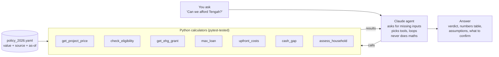

# 🏠 BTO Affordability Agent

**"Can we afford a 4-room BTO in Tengah?"** An AI agent that answers this for any Singapore household, using 2026 HDB and CPF rules, and shows exactly where every number comes from.

<!-- Replace with your demo GIF: record a 30-second run of one example question -->


**Live app:** _add your Streamlit Cloud link here_

## Why I built this

Most couples in their 20s piece this question together from HDB pages, CPF pages and blog posts. Each source covers one piece: grants, loan limits or prices. None of them shows the whole picture for *your* incomes and savings, and many blogs are still out of date (the 80% LTV and the $14,000 income ceiling no longer apply).

## How it works



**The design choice:** the LLM never does arithmetic. It decides which calculator to call and explains the result. All money maths lives in small, typed, tested Python functions, and every policy number lives in one dated YAML file with a source link. A rule change is a one-line edit.

## How the numbers are computed

1. **Eligibility:** combined gross monthly income ≤ $16,000 for families (≤ $8,000 for singles aged 35+).
2. **Grant:** Enhanced CPF Housing Grant from HDB's 16-band income table, up to $120,000.
3. **HDB loan:** the smallest of three limits:
   - 75% of the flat price (LTV)
   - the loan whose instalment is 30% of gross income (MSR)
   - price minus grants (what you actually need)
4. **Instalment:** standard annuity formula at 2.6% p.a.

   `instalment = L × r / (1 − (1 + r)^−n)`, where `r = 2.6% / 12` and `n = 12 × tenure`

5. **Cash gap:** price − grant − loan = downpayment. CPF OA pays first, then cash, plus upfront costs (option fee, stamp duty, legal). The verdict is **tight** if you'd have under 6 months of instalments left in cash.

## Policy values (as of 24 Oct 2026)

| Rule | Value | Source |
| --- | --- | --- |
| Income ceiling, families | $16,000/month (from 24 Aug 2026) | [PropertyNet](https://propertynet.sg/ndr-2026-bto-income-ceiling-16000-ec-18000-extra-ballot-chances/) |
| Income ceiling, singles 35+ | $8,000/month | same |
| EHG, families | up to $120,000, ceiling $9,000 | [gov.sg](https://www.togetherforbetter.gov.sg/lifestage/youngadults/) |
| HDB loan rate | 2.6% p.a. | [EdgeProp](https://www.edgeprop.sg/property-news/guide-hdb-concessionary-housing-loan) |
| LTV / MSR | 75% / 30% | [ShopBack](https://www.shopback.sg/blog/finance/hdb-vs-bank-loan) |
| Tengah Garden Ave 4-room | ~$360k–$380k indicative (Nov 2026 exercise) | [SG Property Index](https://sgpropertyindex.com/launches/bto/tengah-garden-avenue/) |

Values marked `verified: false` in `policy_2026.yaml` (singles EHG bands, stamp duty tiers, option fee, legal estimate, tenure age rule) are shown as warnings in the app until confirmed on hdb.gov.sg and iras.gov.sg.

## Tested scenarios

`tests/test_scenarios.py` covers eight real households: a typical dual-income couple, a couple just above the $9,000 grant cliff, a couple eligible only under the new $16,000 ceiling, a couple above it, a single-income household where the 30% MSR binds, a single aged 35+, a citizen + PR couple, and low-CPF vs high-CPF households. Plus an older buyer whose loan tenure shrinks while waiting for keys.

```
50 passed
```

## Run it

```bash
python -m venv .venv
source .venv/bin/activate          # Windows: .venv\Scripts\activate
pip install -r requirements.txt
cp .env.example .env               # then paste your Anthropic API key
pytest                             # 50 tests, no API key needed
streamlit run app.py               # web app
python cli.py                      # or chat in the terminal
```

## Project structure

```
bto-agent/
├── app.py                 Streamlit UI: chat + waterfall chart + MSR bar + tool-call log
├── cli.py                 Terminal version
├── policy_2026.yaml       Every policy number, with source and as-of date
├── agent/
│   ├── agent.py           Tool-use loop (Anthropic SDK)
│   └── tools.py           Tool schemas + dispatcher
├── calculators/           Pure functions, no LLM
│   ├── eligibility.py  grants.py  loan.py  upfront.py  cash.py
│   ├── assess.py          Chains them for a full assessment
│   └── policy.py          Loads the YAML, flags stale/unverified values
└── tests/                 Unit tests, 8 household scenarios, agent loop with a fake client
```

## Limitations

- Prices for the November 2026 exercise are indicative until HDB publishes them at launch.
- Assumes first-timers and that current income equals the 12-month average HDB uses.
- Does not model the Proximity Housing Grant (resale only), resale flats, bank loans or ECs.
- Downpayment staging (signing vs key collection) is not modelled; the tool shows the total.

**Estimate only. Your HDB Flat Eligibility (HFE) letter is the official answer. Not financial advice.**
